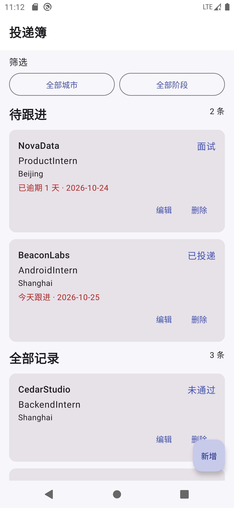
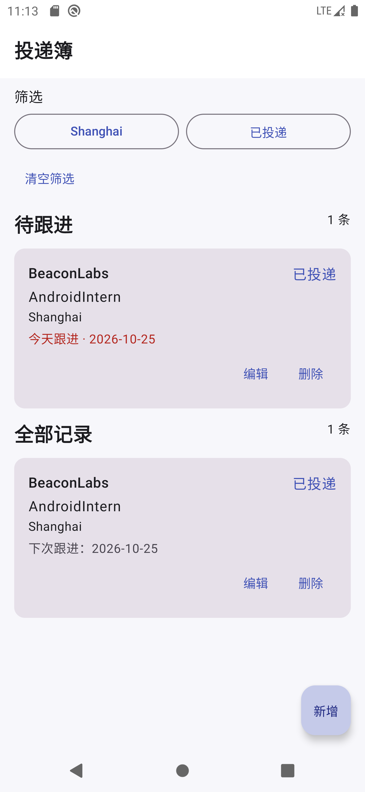
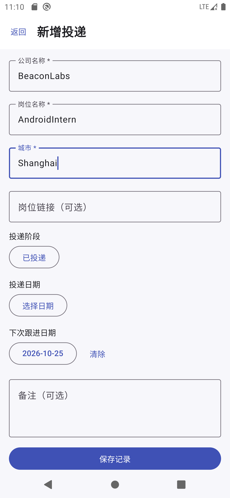
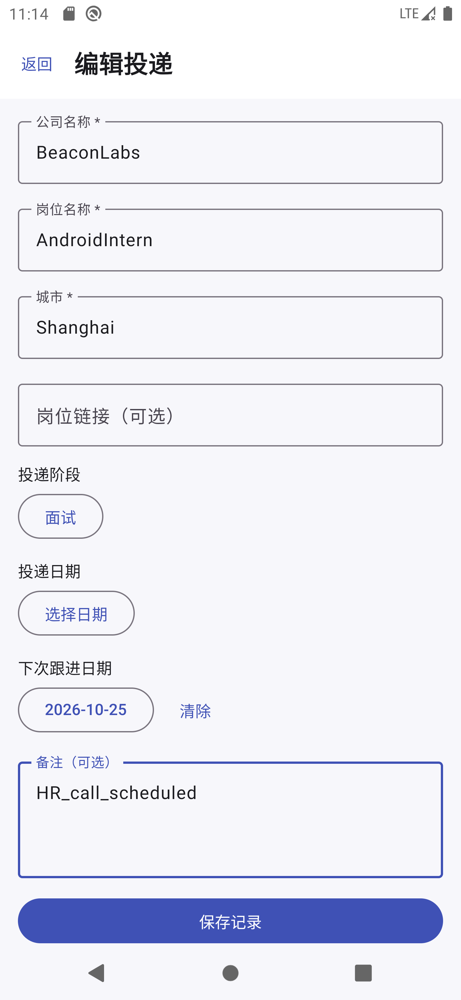
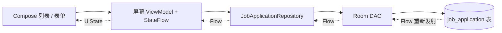

# 投递簿 · InternshipTracker

一个离线 Android 实习投递跟踪 App。记录公司、岗位、城市、阶段与跟进日期，在首页同时查看全部投递和今天/逾期的待跟进事项。首版聚焦可演示的完整本地流程，不需要账号或网络。

> 本项目是在当前 `TaskTracker` 工程中继续开发，保留原有源码与[旧版说明](docs/TaskTracker_旧版说明.md)。运行入口已切换为投递簿；旧待办页面不再出现在当前导航中。新的安装包 ID 为 `com.portfolio.internshiptracker`，源码命名空间沿用现有工程的 `com.example.tasktracker`。

## 运行截图

本节图片取自 Pixel 6 Pro Android 10 模拟器上实际运行的 Debug APK；图中公司、岗位和备注均为演示数据。旧版 TaskTracker 截图仍保存在同一目录，文件名为 `01-*.png` 至 `10-*.png`。

| 待跟进与全部记录 | 城市、阶段组合筛选 |
| :---: | :---: |
|  |  |

| 新增表单 | 编辑阶段与备注 |
| :---: | :---: |
|  |  |

## 已实现功能

| 需求 | 实现 |
| --- | --- |
| FR-01 新增 | 公司、岗位、城市必填；岗位链接、投递日期、跟进日期和备注可选；保存后 Room Flow 使列表更新。 |
| FR-02 查看/编辑 | 列表显示核心字段；同一表单按记录 ID 加载并编辑，保留原创建时间。 |
| FR-03 阶段 | 待投递、已投递、笔试、面试、Offer、未通过六阶段，可任意调整；终态不进入待跟进区。 |
| FR-04 组合筛选 | 城市与阶段同时生效，并同时作用于全部记录与待跟进区；可清空，有筛选空态。 |
| FR-05 待跟进 | 本地日期早于或等于今天、且阶段非终态时进入清单；逾期/今天分开标识，按日期升序。 |
| FR-06 删除/撤销 | 删除后约 5 秒内可撤销；恢复原 ID、全部字段及时间戳。 |
| FR-07 本地持久化 | 新业务记录只写 Room；跨页面、旋转和重启后读取已保存数据。 |
| FR-08 校验与异常 | 必填项去空格校验，非空链接仅接受有效 http/https 主机，日期选择器，保存失败保留输入；列表空态与筛选空态分开。 |

## 架构与数据流



单 `app` 模块、单 Activity。列表从 Room 的观察流和筛选/今天状态推导 UI，不长期复制一份可变数据库列表。新增/编辑只通过导航传 `recordId`；Repository 管理实体与业务模型映射、校验和写入。只有数据库写入成功，表单才提示成功并返回。删除时 DAO 在事务中取得快照，撤销以原主键插回。日期用 `LocalDate.toEpochDay()` 存储，以设备本地日历日判断到期；回到前台时刷新今天。

主要代码：

- [入口](app/src/main/java/com/example/tasktracker/MainActivity.kt)、[导航](app/src/main/java/com/example/tasktracker/internship/ui/navigation/InternshipNavHost.kt)
- [列表页面](app/src/main/java/com/example/tasktracker/internship/ui/list/ApplicationListScreen.kt)、[列表 ViewModel](app/src/main/java/com/example/tasktracker/internship/ui/list/ApplicationListViewModel.kt)
- [表单页面](app/src/main/java/com/example/tasktracker/internship/ui/form/ApplicationFormScreen.kt)、[表单 ViewModel](app/src/main/java/com/example/tasktracker/internship/ui/form/ApplicationFormViewModel.kt)
- [Repository](app/src/main/java/com/example/tasktracker/internship/data/JobApplicationRepository.kt)、[DAO](app/src/main/java/com/example/tasktracker/internship/data/JobApplicationDao.kt)、[业务规则](app/src/main/java/com/example/tasktracker/internship/util/ApplicationRules.kt)
- [Room v1 schema](app/schemas/com.example.tasktracker.internship.data.InternshipDatabase/1.json)

## 构建与运行

需要 JDK 17、Android SDK Platform 35、Android Build Tools 35、可运行的 Android 模拟器或设备。Gradle Wrapper 8.9 已随工程提供。Windows PowerShell 在项目根目录执行：

```powershell
.\gradlew.bat :app:assembleDebug
.\gradlew.bat :app:testDebugUnitTest
.\gradlew.bat :app:lintDebug
.\gradlew.bat :app:connectedDebugAndroidTest
```

用 Android Studio 打开项目，或对已连接设备执行 `adb install -r app\build\outputs\apk\debug\app-debug.apk`。如命令行无法找到 SDK，在未提交的 `local.properties` 中设置 `sdk.dir`。本次实际生成的 [Debug APK](app/build/outputs/apk/debug/app-debug.apk) 位于 `app/build/outputs/apk/debug/app-debug.apk`。

### 依赖版本与选择

版本集中在 [gradle/libs.versions.toml](gradle/libs.versions.toml)：AGP 8.7.3、Gradle 8.9、Kotlin 2.0.21、KSP 2.0.21-1.0.28、Compose BOM 2024.12.01、Navigation Compose 2.8.5、Room 2.8.5、Hilt 2.54、Lifecycle 2.8.7。沿用原项目可工作的 AGP/Kotlin/SDK 35 组合，选用兼容它的稳定 Navigation/Compose 线；Room 采用 2.x 稳定补丁版。Compose BOM 不管理 Kotlin 编译器、Navigation、Room 或 Hilt。Room 用 KSP2，Hilt 用 kapt；保留的旧版源码仍引用 DataStore，当前投递记录并不使用它。

选择依据：[Android 构建工具兼容说明](https://developer.android.com/build/releases/about-agp)、[Compose BOM](https://developer.android.com/develop/ui/compose/bom)、[Room 发布说明](https://developer.android.com/jetpack/androidx/releases/room)、[Navigation 发布说明](https://developer.android.com/jetpack/androidx/releases/navigation)。

## 验证记录（2026-10-25）

| 验证 | 本机结果 |
| --- | --- |
| `:app:assembleDebug` | 通过，生成 Debug APK |
| `:app:testDebugUnitTest` | 通过，8 项测试，0 失败（含旧版 2 项、新业务 6 项） |
| `:app:lintDebug` | 通过 |
| `:app:connectedDebugAndroidTest` | Pixel 6 Pro，Android 10 / API 29 模拟器上通过，3 项测试，0 失败 |
| 手工演示 | 见 [实现与验收报告](IMPLEMENTATION_REPORT.md) |

自动化测试覆盖日期边界与组合筛选、设备时区变化、Room 增改删和原 ID 撤销、Compose 新增→列表→编辑阶段→删除撤销流程。测试源码在 `app/src/test` 与 `app/src/androidTest`；详细结果及手工验收见[实现与验收报告](IMPLEMENTATION_REPORT.md)。

## 设计取舍与已知限制

- 首版只提供应用内待跟进清单，没有系统通知、云同步、JSON 导入导出或账号功能。
- 两个页面、一个业务实体，保持单模块；此时增加空的 Domain 模块或 UseCase 层会增加维护成本。
- 城市保留用户原始输入，展示和筛选时 trim，筛选比较忽略大小写；同公司同岗位允许多条记录。
- `exportSchema=true` 并提交 v1 schema。当前还没有业务数据库升级，因此没有虚构迁移；也没有开启破坏性迁移。
- 应用重回前台时更新本地“今天”；若一直停留在前台跨过午夜，需要离开再返回应用刷新。
- 不申请网络权限。Manifest 设置 `allowBackup=false`，但 Android 设备间传输行为仍取决于系统版本和厂商实现。不要在备注中输入密码等敏感信息。
- 原 TaskTracker 源码为保护用户现有工作而保留，仍参与编译；当前导航和记录数据源与它分离。

## 一次真实排错

最初升级 Room 到 2.8.5 后，旧 KSP1 处理器在 schema 导出时报 `FieldBundle$$serializer.typeParametersSerializers()` 的 `AbstractMethodError`。切到 KSP2 后，Hilt 2.53.1 在该环境的生成代码/Windows kapt 路径上继续失败。将 Room 保持在 KSP2、Hilt 编译器改走 kapt 并升到 Hilt 2.54 后，重新运行编译、单测、Lint 和仪器化测试，全部通过。相关背景见 [KSP2 文档](https://github.com/google/ksp/blob/main/docs/ksp2.md)和 [Dagger Windows 路径问题](https://github.com/google/dagger/issues/4533)。

## 60–90 秒演示脚本

1. 启动空应用，新增三条**虚构**投递记录，分别设置不同城市和阶段，其中一条跟进日期选今天或过去。
2. 回到列表展示“待跟进”及“全部记录”；同时选择城市和阶段，再清空筛选。
3. 打开一条记录，修改阶段和备注并保存；删除一条并在 5 秒内撤销。
4. 强制关闭再打开应用，确认已保存记录仍在列表中。

[面试技术与设计问答（Markdown）](docs/实习投递跟踪App_面试问答.md)覆盖架构、Compose、Room、日期、状态、测试、取舍与常见追问。
