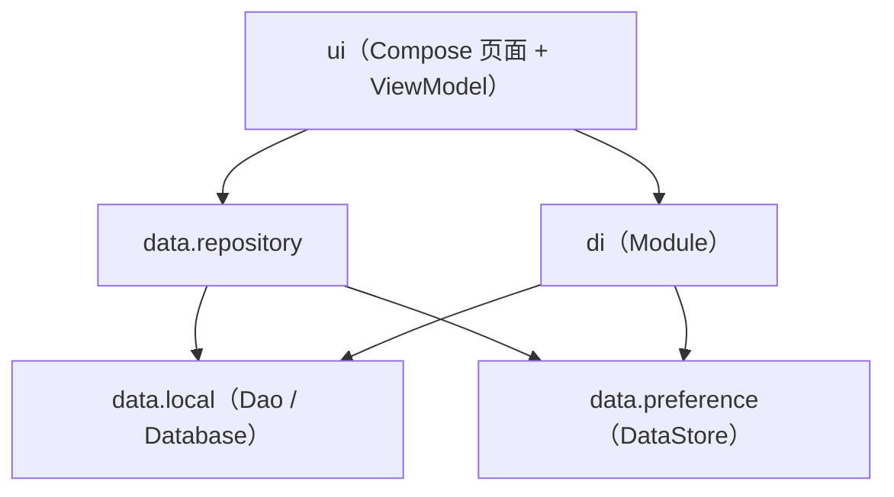

# TaskTracker 项目实战指南
### Kotlin + Jetpack Compose + Hilt + Room + DataStore 五件套本地协同（单模块 · 两天速成）

> 目标：零基础也能跑起来的「实习面试展示 App」。
> 技术栈：**Kotlin + Jetpack Compose + Hilt + Room + DataStore**
> 约束：**单模块（app）**、不联网、不申请权限、不引第三方 SDK。
> 所有 API 均为**当前稳定版**，不含已废弃（deprecated）或实验性（experimental / `@OptIn`）用法。

---

## 目录

- [0. 两天学习路线](#0-两天学习路线)
- [1. 项目结构总览](#1-项目结构总览)
- [2. Gradle 配置（版本兼容清单）](#2-gradle-配置版本兼容清单)
  - [2.1 `gradle/libs.versions.toml` 版本目录](#21-gradlelibsversionstoml-版本目录)
  - [2.2 根 `build.gradle.kts`](#22-根-buildgradlekts)
  - [2.3 `settings.gradle.kts`](#23-settingsgradlekts)
  - [2.4 模块 `app/build.gradle.kts`](#24-模块-appbuildgradlekts)
  - [2.5 `gradle.properties`](#25-gradleproperties)
  - [2.6 `AndroidManifest.xml`](#26-androidmanifestxml)
- [3. 代码实现（按依赖方向从底向上）](#3-代码实现按依赖方向从底向上)
  - [3.1 Task 实体类（Room）](#31-task-实体类room)
  - [3.2 TaskDao 接口（Room）](#32-taskdao-接口room)
  - [3.3 AppDatabase 抽象类（Room）](#33-appdatabase-抽象类room)
  - [3.4 ThemeMode 与 UserPreferences（DataStore）](#34-thememode-与-userpreferencesdatastore)
  - [3.5 DataStore 封装类（PreferencesDataStore）](#35-datastore-封装类preferencesdatastore)
  - [3.6 Repository（Dao + DataStore 协同）](#36-repositorydao--datastore-协同)
  - [3.7 Hilt Module（DI 装配）](#37-hilt-moduledi-装配)
  - [3.8 Application 类（Hilt 初始化 + 全局配置）](#38-application-类hilt-初始化--全局配置)
  - [3.9 ViewModel（HiltViewModel + StateFlow）](#39-viewmodelhiltviewmodel--stateflow)
  - [3.10 UI State 与主题（Compose Theme）](#310-ui-state-与主题compose-theme)
  - [3.11 Compose 页面：任务列表页](#311-compose-页面任务列表页)
  - [3.12 Compose 页面：添加任务页（ModalBottomSheet）](#312-compose-页面添加任务页modalbottomsheet)
  - [3.13 NavigationHost（NavHost + 两个目的地）](#313-navigationhostnavhost--两个目的地)
  - [3.14 MainActivity（最小可启动配置）](#314-mainactivity最小可启动配置)
- [4. 数据流转全景图](#4-数据流转全景图)
- [5. 面试高频问答（对着代码答）](#5-面试高频问答对着代码答)
- [6. 常见坑与排错](#6-常见坑与排错)
- [7. 两天实操排期](#7-两天实操排期)

---

## 0. 两天学习路线

| 时段 | 任务 | 验收标准 |
|---|---|---|
| Day1 上午 | 建工程、配 Gradle、跑通空 Compose 页面 | 模拟器显示「Hello」 |
| Day1 下午 | Room 三件套（Entity / Dao / Database）+ Repository | Logcat 能打出插入后的任务列表 |
| Day1 晚 | Hilt Module + Application + ViewModel | ViewModel 能拿到 Repository 数据 |
| Day2 上午 | Compose 列表页 + 添加页 + 导航 | 能新增任务并在列表看到 |
| Day2 下午 | DataStore 主题切换 + Snackbar + 勾选/删除 | 切主题后重启 App 偏好保留 |
| Day2 晚 | 通读第 5 节问答，能口述数据流 | 面试可讲 5 分钟 |

---

## 1. 项目结构总览

单模块，按**分层职责**分包（不是按类型分包，面试更显专业）：

```
TaskTracker/                          ← 工程根目录
├── settings.gradle.kts               ← 声明模块与仓库
├── build.gradle.kts                  ← 根构建脚本（插件统一管理）
├── gradle.properties                 ← JVM 参数 / AndroidX 开关
├── gradle/
│   └── libs.versions.toml            ← ★ 版本目录（所有依赖版本集中一处）
└── app/                              ← 唯一模块
    ├── build.gradle.kts              ← 模块依赖声明
    └── src/main/
        ├── AndroidManifest.xml
        ├── java/com/example/tasktracker/
        │   ├── TaskTrackerApp.kt              ← Application：@HiltAndroidApp
        │   │
        │   ├── data/                          ← 数据层（Room + DataStore）
        │   │   ├── local/
        │   │   │   ├── Task.kt                ← @Entity 实体
        │   │   │   ├── TaskDao.kt             ← DAO 接口
        │   │   │   └── AppDatabase.kt         ← @Database 抽象类
        │   │   ├── preference/
        │   │   │   ├── ThemeMode.kt           ← 主题枚举
        │   │   │   └── UserPreferences.kt     ← DataStore 封装类
        │   │   └── repository/
        │   │       └── TaskRepository.kt      ← 仓库实现（Dao + DataStore）
        │   │
        │   ├── di/                            ← 依赖注入
        │   │   └── AppModule.kt               ← @Module + @Provides
        │   │
        │   ├── ui/                            ← UI 层（纯 Compose）
        │   │   ├── theme/
        │   │   │   ├── Color.kt
        │   │   │   ├── Theme.kt               ← 明暗主题装配
        │   │   │   └── Type.kt
        │   │   ├── task/
        │   │   │   ├── TaskListScreen.kt      ← 列表页（LazyColumn）
        │   │   │   ├── AddTaskSheet.kt        ← 添加页（ModalBottomSheet）
        │   │   │   └── TaskViewModel.kt       ← @HiltViewModel
        │   │   └── navigation/
        │   │       └── AppNavHost.kt          ← NavHost + 路由常量
        │   │
        │   └── MainActivity.kt                ← 唯一 Activity（setContent）
        └── res/
            └── values/
                ├── strings.xml
                └── themes.xml                 ← 仅用于启动窗口，样式交给 Compose
```

**分层依赖方向（单向，不允许反向）：**



> 记忆口诀：**UI 只认 Repository，Repository 只认 Dao 与 DataStore，谁创建实例交给 Hilt。**

---

## 2. Gradle 配置（版本兼容清单）

### 2.1 `gradle/libs.versions.toml` 版本目录

> 这是 Gradle 官方的**版本目录（Version Catalog）**，把「版本号 + 坐标」集中成一个 `libs.xxx.yyy` 别名，避免各模块版本写散、写冲突。**这是当前官方推荐做法**，非实验性 API。

```toml
# gradle/libs.versions.toml
[versions]
# —— 构建工具链 ——
agp = "8.7.3"                 # Android Gradle Plugin（需与 Gradle 版本匹配）
kotlin = "2.0.21"             # Kotlin 2.x
ksp = "2.0.21-1.0.28"         # KSP 版本号 = Kotlin 版本号 + 后缀，必须严格对应

# —— AndroidX 基础 ——
coreKtx = "1.15.0"
lifecycle = "2.8.7"           # lifecycle-runtime-ktx / lifecycle-viewmodel-compose
activityCompose = "1.9.3"

# —— Compose ——
composeBom = "2024.12.01"     # ★ Compose BOM：统一管理所有 compose-* 库版本
navigationCompose = "2.8.5"   # ★ Navigation for Compose（注意不进 BOM）

# —— Jetpack 五件套另外三件 ——
room = "2.6.1"                # ★ Room
hilt = "2.53.1"               # ★ Hilt（含 dagger）
hiltNavigationCompose = "1.2.0"  # ★ hiltViewModel() 扩展
datastore = "1.1.1"           # ★ DataStore（Preferences + Core）

# —— 测试 ——
junit = "4.13.2"
androidxJunit = "1.2.1"
espresso = "3.6.1"

[libraries]
# —— 基础 ——
androidx-core-ktx          = { group = "androidx.core",               name = "core-ktx",                  version.ref = "coreKtx" }
androidx-lifecycle-runtime-ktx = { group = "androidx.lifecycle",      name = "lifecycle-runtime-ktx",     version.ref = "lifecycle" }
androidx-lifecycle-viewmodel-compose = { group = "androidx.lifecycle", name = "lifecycle-viewmodel-compose", version.ref = "lifecycle" }
androidx-activity-compose   = { group = "androidx.activity",          name = "activity-compose",          version.ref = "activityCompose" }

# —— Compose（统一走 BOM，无需写版本）——
androidx-compose-bom        = { group = "androidx.compose",           name = "compose-bom",               version.ref = "composeBom" }
androidx-ui                 = { group = "androidx.compose.ui",        name = "ui" }
androidx-ui-graphics        = { group = "androidx.compose.ui",        name = "ui-graphics" }
androidx-ui-tooling         = { group = "androidx.compose.ui",        name = "ui-tooling" }
androidx-ui-tooling-preview = { group = "androidx.compose.ui",        name = "ui-tooling-preview" }
androidx-material3          = { group = "androidx.compose.material3", name = "material3" }
androidx-material-icons-extended = { group = "androidx.compose.material", name = "material-icons-extended" }
androidx-navigation-compose = { group = "androidx.navigation",        name = "navigation-compose",        version.ref = "navigationCompose" }

# —— Room ——
room-runtime = { group = "androidx.room", name = "room-runtime", version.ref = "room" }
room-ktx     = { group = "androidx.room", name = "room-ktx",     version.ref = "room" }
room-compiler= { group = "androidx.room", name = "room-compiler",version.ref = "room" }

# —— Hilt ——
hilt-android          = { group = "com.google.dagger", name = "hilt-android",           version.ref = "hilt" }
hilt-compiler         = { group = "com.google.dagger", name = "hilt-android-compiler",  version.ref = "hilt" }
androidx-hilt-navigation-compose = { group = "androidx.hilt", name = "hilt-navigation-compose", version.ref = "hiltNavigationCompose" }

# —— DataStore ——
androidx-datastore-preferences = { group = "androidx.datastore", name = "datastore-preferences", version.ref = "datastore" }

# —— 测试 ——
junit           = { group = "junit",                 name = "junit",         version.ref = "junit" }
androidx-junit  = { group = "androidx.test.ext",     name = "junit",         version.ref = "androidxJunit" }
androidx-espresso-core = { group = "androidx.test.espresso", name = "espresso-core", version.ref = "espresso" }

[plugins]
android-application = { id = "com.android.application",          version.ref = "agp" }
kotlin-android      = { id = "org.jetbrains.kotlin.android",     version.ref = "kotlin" }
kotlin-compose      = { id = "org.jetbrains.kotlin.plugin.compose", version.ref = "kotlin" }
ksp                 = { id = "com.google.devtools.ksp",          version.ref = "ksp" }
hilt                = { id = "com.google.dagger.hilt.android",    version.ref = "hilt" }
```

**版本兼容三原则（面试必答）：**

1. **Kotlin ↔ KSP ↔ Compose 编译器**：Kotlin 2.0 起，Compose 编译器由 `org.jetbrains.kotlin.plugin.compose` 提供，版本**跟随 Kotlin**，不再有独立的 `composeOptions.kotlinCompilerExtensionVersion`。
2. **KSP 版本号 = Kotlin 版本号 + `-1.0.x`**：`2.0.21` ↔ `2.0.21-1.0.28`，写错直接构建失败。
3. **AGP ↔ Gradle**：AGP 8.7.x 需要 Gradle 8.9+，见 `gradle/wrapper/gradle-wrapper.properties`。

### 2.2 根 `build.gradle.kts`

```kotlin
// build.gradle.kts（工程根目录）
plugins {
    // 只声明、不应用（apply false），具体应用交给子模块
    alias(libs.plugins.android.application) apply false
    alias(libs.plugins.kotlin.android) apply false
    alias(libs.plugins.kotlin.compose) apply false   // Compose 编译器插件
    alias(libs.plugins.ksp) apply false              // KSP（Room/Hilt 注解处理）
    alias(libs.plugins.hilt) apply false             // Hilt 插件
}
```

### 2.3 `settings.gradle.kts`

```kotlin
// settings.gradle.kts
pluginManagement {
    repositories {
        google {
            content {
                includeGroupByRegex("com\\.android.*")
                includeGroupByRegex("com\\.google.*")
                includeGroupByRegex("androidx.*")
            }
        }
        mavenCentral()
        gradlePluginPortal()
    }
}

dependencyResolutionManagement {
    repositoriesMode.set(RepositoriesMode.FAIL_ON_PROJECT_REPOS)
    repositories {
        google()
        mavenCentral()
    }
}

rootProject.name = "TaskTracker"
include(":app")   // 单模块：只有一个 app
```

### 2.4 模块 `app/build.gradle.kts`

```kotlin
// app/build.gradle.kts
plugins {
    alias(libs.plugins.android.application)
    alias(libs.plugins.kotlin.android)
    alias(libs.plugins.kotlin.compose)   // 必须，否则 @Composable 编译不过
    alias(libs.plugins.ksp)              // 必须，Room/Hilt 注解处理器走 KSP
    alias(libs.plugins.hilt)
}

android {
    namespace = "com.example.tasktracker"
    compileSdk = 35

    defaultConfig {
        applicationId = "com.example.tasktracker"
        minSdk = 24
        targetSdk = 35
        versionCode = 1
        versionName = "1.0"
        testInstrumentationRunner = "androidx.test.runner.AndroidJUnitRunner"
    }

    buildTypes {
        release {
            isMinifyEnabled = false
            proguardFiles(
                getDefaultProguardFile("proguard-android-optimize.txt"),
                "proguard-rules.pro"
            )
        }
    }

    compileOptions {
        sourceCompatibility = JavaVersion.VERSION_17
        targetCompatibility = JavaVersion.VERSION_17
    }

    kotlinOptions {
        jvmTarget = "17"
    }

    buildFeatures {
        compose = true          // 开启 Compose
    }

    packaging {
        resources {
            excludes += "/META-INF/{AL2.0,LGPL2.1}"
        }
    }
}

dependencies {
    // —— 基础 ——
    implementation(libs.androidx.core.ktx)
    implementation(libs.androidx.lifecycle.runtime.ktx)
    implementation(libs.androidx.activity.compose)

    // —— Compose（BOM 统一版本，后续 compose 库全部不带版本号）——
    implementation(platform(libs.androidx.compose.bom))
    implementation(libs.androidx.ui)
    implementation(libs.androidx.ui.graphics)
    implementation(libs.androidx.ui.tooling.preview)
    implementation(libs.androidx.material3)
    implementation(libs.androidx.material.icons.extended)
    // ★ Navigation for Compose 不在 BOM 内，必须显式写版本
    implementation(libs.androidx.navigation.compose)
    implementation(libs.androidx.lifecycle.viewmodel.compose)

    // —— Room ——
    implementation(libs.room.runtime)
    implementation(libs.room.ktx)             // 提供 suspend / Flow 支持
    ksp(libs.room.compiler)                   // 注解处理器用 ksp 而非 kapt

    // —— Hilt ——
    implementation(libs.hilt.android)
    ksp(libs.hilt.compiler)
    implementation(libs.androidx.hilt.navigation.compose)   // hiltViewModel()

    // —— DataStore ——
    implementation(libs.androidx.datastore.preferences)

    // —— 调试工具（仅 debug 构建）——
    debugImplementation(libs.androidx.ui.tooling)

    // —— 测试 ——
    testImplementation(libs.junit)
    androidTestImplementation(libs.androidx.junit)
    androidTestImplementation(libs.androidx.espresso.core)
    androidTestImplementation(platform(libs.androidx.compose.bom))
}
```

> **为什么用 KSP 而不是 kapt？** kapt 基于 Java 注解处理器，需要先生成 Java 桩代码，编译慢；KSP 原生理解 Kotlin 符号，速度更快，且 **Room 2.6+ / Hilt 2.48+ 官方已完整支持并推荐 KSP**。

### 2.5 `gradle.properties`

```properties
# gradle.properties
org.gradle.jvmargs=-Xmx2048m -Dfile.encoding=UTF-8
org.gradle.parallel=true
org.gradle.caching=true

android.useAndroidX=true
android.nonTransitiveRClass=true

kotlin.code.style=official
```

### 2.6 `AndroidManifest.xml`

```xml
<?xml version="1.0" encoding="utf-8"?>
<manifest xmlns:android="http://schemas.android.com/apk/res/android">

    <!-- 无网络、无权限申请：本 App 纯本地 -->

    <application
        android:name=".TaskTrackerApp"          <!-- ★ 指向自定义 Application -->
        android:allowBackup="true"
        android:icon="@mipmap/ic_launcher"
        android:label="@string/app_name"
        android:supportsRtl="true"
        android:theme="@style/Theme.TaskTracker">

        <activity
            android:name=".MainActivity"
            android:exported="true"
            android:theme="@style/Theme.TaskTracker">
            <intent-filter>
                <action android:name="android.intent.action.MAIN" />
                <category android:name="android.intent.category.LAUNCHER" />
            </intent-filter>
        </activity>
    </application>
</manifest>
```

```xml
<!-- res/values/strings.xml -->
<resources>
    <string name="app_name">TaskTracker</string>
</resources>
```

```xml
<!-- res/values/themes.xml：只作为启动窗口样式，真正的主题由 Compose 接管 -->
<resources>
    <style name="Theme.TaskTracker" parent="android:Theme.Material.Light.NoActionBar" />
</resources>
```

---

## 3. 代码实现（按依赖方向从底向上）

### 3.1 Task 实体类（Room）

```kotlin
package com.example.tasktracker.data.local

import androidx.room.Entity
import androidx.room.PrimaryKey

/**
 * 待办任务实体，对应数据库中的 task 表。
 *
 * 字段说明：
 * - id        ：主键，自增。autoGenerate = true 时由 Room 自动分配。
 * - title     ：任务标题，非空。
 * - isDone    ：是否完成。Room 支持 Boolean，底层存为 0/1。
 * - createdAt ：创建时间戳（毫秒）。默认取当前系统时间。
 */
@Entity(tableName = "task")
data class Task(
    @PrimaryKey(autoGenerate = true)
    val id: Long = 0L,

    val title: String,

    val isDone: Boolean = false,

    val createdAt: Long = System.currentTimeMillis()
)
```

> **注意点**
> - `@PrimaryKey(autoGenerate = true)` 时，`id` 默认值必须给 `0L`，插入时 Room 会忽略该值并回填真实 id。
> - data class 的 `equals/hashCode` 由编译器生成，Compose 的 `LazyColumn` 依赖它做 diff 优化，**不要写成普通 class**。

### 3.2 TaskDao 接口（Room）

```kotlin
package com.example.tasktracker.data.local

import androidx.room.Dao
import androidx.room.Delete
import androidx.room.Insert
import androidx.room.OnConflictStrategy
import androidx.room.Query
import androidx.room.Update
import kotlinx.coroutines.flow.Flow

/**
 * 任务表数据访问接口。Room 在编译期生成实现类 TaskDao_Impl。
 *
 * 异步查询说明：
 * - 返回 Flow<List<Task>> 的查询是「可观察查询」，数据表变化时自动重新发射。
 * - 增删改统一用 suspend，由 Room 自动切到 IO 线程，不阻塞主线程。
 */
@Dao
interface TaskDao {

    /** 插入一条任务；返回新行的主键 id。 */
    @Insert(onConflict = OnConflictStrategy.REPLACE)
    suspend fun insert(task: Task): Long

    /** 查询全部任务，按创建时间倒序（最新的在最上面）。 */
    @Query("SELECT * FROM task ORDER BY createdAt DESC")
    fun observeAll(): Flow<List<Task>>

    /** 只查询未完成任务，同样按创建时间倒序。 */
    @Query("SELECT * FROM task WHERE isDone = 0 ORDER BY createdAt DESC")
    fun observeActive(): Flow<List<Task>>

    /** 更新任务（按主键匹配），常用于切换完成状态或改名。 */
    @Update
    suspend fun update(task: Task)

    /** 删除任务（按主键匹配）。 */
    @Delete
    suspend fun delete(task: Task)

    /** 按 id 删除，便于从 UI 只拿到 id 的场景。 */
    @Query("DELETE FROM task WHERE id = :taskId")
    suspend fun deleteById(taskId: Long)
}
```

> **易混淆点**：同一个 `@Query` 方法，返回 `Flow` 就是可观察的（自动推送），返回普通类型（如 `suspend fun getAll(): List<Task>`）就是一次性读取。**列表页务必用 Flow**，否则增删后 UI 不刷新。

### 3.3 AppDatabase 抽象类（Room）

```kotlin
package com.example.tasktracker.data.local

import androidx.room.Database
import androidx.room.RoomDatabase

/**
 * Room 数据库抽象类。
 *
 * - entities    ：声明参与建表的实体类。
 * - version     ：数据库版本号；改表结构必须 +1，否则运行时报错。
 * - exportSchema ：关闭 schema 导出可避免未配 schemaDirectory 的告警；
 *                  生产项目建议开启并纳入版本管理（本 Demo 关闭）。
 *
 * 注意：这里只写抽象方法，实例由 Hilt 在 AppModule 中创建。
 */
@Database(
    entities = [Task::class],
    version = 1,
    exportSchema = false
)
abstract class AppDatabase : RoomDatabase() {

    /** 暴露 DAO，Repository 通过它访问数据。 */
    abstract fun taskDao(): TaskDao

    companion object {
        /** 数据库文件名常量，供 Module 使用。 */
        const val DB_NAME = "task_tracker.db"
    }
}
```

> **为什么要抽象类而不是接口？** Room 固定要求 `@Database` 标注的类继承 `RoomDatabase`，而 `RoomDatabase` 是抽象类，所以只能用 `abstract class`。
>
> **异步查询**：Room 的异步能力来自两点——`suspend` 函数（Room 内部调度到自己的 IO 线程池）+ `Flow` 返回类型（配合 `room-ktx`）。**不需要手写 `withContext(Dispatchers.IO)`**。

### 3.4 ThemeMode 与 UserPreferences（DataStore）

**明确选择：本指南使用 `PreferencesDataStore`。**
理由：本场景只存「主题模式」这种简单的键值对偏好，Preferences 类型无需定义 `.proto` 与额外 Gradle 插件，**零配置、上手最快**，最契合「两天速成」。ProtoDataStore 适合结构化强类型数据，本 Demo 没必要。**全程只用 Preferences，保持一致性。**

```kotlin
package com.example.tasktracker.data.preference

/**
 * 主题模式枚举。
 * - SYSTEM ：跟随系统
 * - LIGHT  ：强制浅色
 * - DARK   ：强制深色
 */
enum class ThemeMode {
    SYSTEM,
    LIGHT,
    DARK;

    companion object {
        /** 把持久化的字符串安全地转回枚举，非法值兜底为 SYSTEM。 */
        fun fromName(value: String?): ThemeMode =
            entries.firstOrNull { it.name == value } ?: SYSTEM
    }
}
```

```kotlin
package com.example.tasktracker.data.preference

import android.content.Context
import androidx.datastore.core.DataStore
import androidx.datastore.preferences.core.Preferences
import androidx.datastore.preferences.core.booleanPreferencesKey
import androidx.datastore.preferences.core.edit
import androidx.datastore.preferences.core.stringPreferencesKey
import androidx.datastore.preferences.preferencesDataStore
import kotlinx.coroutines.flow.Flow
import kotlinx.coroutines.flow.map

/** 顶层属性扩展：全进程只允许创建一个 DataStore 实例，写在文件顶层是官方推荐写法。 */
private val Context.dataStore: DataStore<Preferences> by preferencesDataStore(
    name = "user_preferences"     // 生成文件：files/datastore/user_preferences.preferences_pb
)

/**
 * 用户偏好封装类（首选用法：构造注入 Context，而不是注入 Context 本身）。
 *
 * 设计要点：
 * - Context 是 applicationContext，不持有 Activity 引用，避免内存泄漏。
 * - 读取用 Flow，写入用 suspend，全程异步、不阻塞主线程。
 */
class UserPreferences(private val context: Context) {

    private object Keys {
        val THEME_MODE = stringPreferencesKey("theme_mode")
        val SHOW_DONE = booleanPreferencesKey("show_done_tasks")
    }

    /** 主题模式，默认跟随系统。UI 侧 collectAsStateWithLifecycle() 订阅。 */
    val themeMode: Flow<ThemeMode> = context.dataStore.data.map { prefs ->
        ThemeMode.fromName(prefs[Keys.THEME_MODE])
    }

    /** 是否显示已完成任务，默认显示。 */
    val showDoneTasks: Flow<Boolean> = context.dataStore.data.map { prefs ->
        prefs[Keys.SHOW_DONE] ?: true
    }

    /** 写入主题模式。 */
    suspend fun setThemeMode(mode: ThemeMode) {
        context.dataStore.edit { prefs ->
            prefs[Keys.THEME_MODE] = mode.name
        }
    }

    /** 写入「是否显示已完成任务」。 */
    suspend fun setShowDoneTasks(show: Boolean) {
        context.dataStore.edit { prefs ->
            prefs[Keys.SHOW_DONE] = show
        }
    }
}
```

> **DataStore 三大铁律（面试必考）**
> 1. **单实例**：同一文件名的 DataStore 在进程中只能创建一次，否则抛 `IllegalStateException`。用 `by preferencesDataStore` 顶层委托可从语法层面保证。
> 2. **不存复杂对象**：Preferences 只支持基础类型；存集合需自行转字符串。
> 3. **不阻塞主线程**：`data` 是 Flow，`edit` 是 suspend，天然异步。**不要用 runBlocking 去读它**。

### 3.5 Repository（Dao + DataStore 协同）

```kotlin
package com.example.tasktracker.data.repository

import com.example.tasktracker.data.local.Task
import com.example.tasktracker.data.local.TaskDao
import com.example.tasktracker.data.preference.ThemeMode
import com.example.tasktracker.data.preference.UserPreferences
import kotlinx.coroutines.flow.Flow

/**
 * 仓库层：App 的「唯一数据入口」。
 *
 * 职责：
 * 1. 对 ViewModel 屏蔽数据来源（Room 还是 DataStore）。
 * 2. 组合多个数据源（任务来自 Room，主题来自 DataStore）。
 * 3. 将来加缓存 / 换网络源，只改这一层，UI 无感知。
 *
 * 构造参数由 Hilt 自动注入，无需手写工厂。
 */
class TaskRepository(
    private val taskDao: TaskDao,
    private val userPreferences: UserPreferences
) {

    // ---------------- 任务相关（Room） ----------------

    /** 观察全部任务。 */
    val allTasks: Flow<List<Task>> = taskDao.observeAll()

    /** 观察未完成任务。 */
    val activeTasks: Flow<List<Task>> = taskDao.observeActive()

    /** 新增任务。 */
    suspend fun addTask(title: String) {
        taskDao.insert(Task(title = title.trim()))
    }

    /** 切换某条任务的完成状态。 */
    suspend fun toggleDone(task: Task) {
        taskDao.update(task.copy(isDone = !task.isDone))
    }

    /** 更新任务（整体替换）。 */
    suspend fun updateTask(task: Task) {
        taskDao.update(task)
    }

    /** 删除任务。 */
    suspend fun deleteTask(task: Task) {
        taskDao.delete(task)
    }

    // ---------------- 偏好相关（DataStore） ----------------

    /** 观察主题模式。 */
    val themeMode: Flow<ThemeMode> = userPreferences.themeMode

    /** 观察是否显示已完成任务。 */
    val showDoneTasks: Flow<Boolean> = userPreferences.showDoneTasks

    /** 设置主题模式。 */
    suspend fun setThemeMode(mode: ThemeMode) {
        userPreferences.setThemeMode(mode)
    }

    /** 设置是否显示已完成任务。 */
    suspend fun setShowDoneTasks(show: Boolean) {
        userPreferences.setShowDoneTasks(show)
    }
}
```

### 3.6 Hilt Module（DI 装配）

```kotlin
package com.example.tasktracker.di

import android.content.Context
import androidx.room.Room
import com.example.tasktracker.data.local.AppDatabase
import com.example.tasktracker.data.local.TaskDao
import com.example.tasktracker.data.preference.UserPreferences
import dagger.Module
import dagger.Provides
import dagger.hilt.InstallIn
import dagger.hilt.android.qualifiers.ApplicationContext
import dagger.hilt.components.SingletonComponent
import javax.inject.Singleton

/**
 * 全局依赖模块。
 *
 * - @InstallIn(SingletonComponent::class)：这些对象随 App 生命周期存活（全局单例）。
 * - @Provides：告诉 Hilt「如何创建这个类型」。
 * - @Singleton：保证同一类型全局只有一个实例。
 *
 * 说明：TaskRepository 用的是 @Inject 构造注入（见 TaskRepository 类），
 * 不需要在 Module 里再写一遍；只有「无法改源码的类」（如 Room、DataStore 封装）
 * 或「需要 Context 才能构造的类」才需要 @Provides。
 */
@Module
@InstallIn(SingletonComponent::class)
object AppModule {

    /** 提供 Room 数据库单例。 */
    @Provides
    @Singleton
    fun provideAppDatabase(
        @ApplicationContext context: Context
    ): AppDatabase = Room.databaseBuilder(
        context,
        AppDatabase::class.java,
        AppDatabase.DB_NAME
    )
        // 改表结构时用 fallback（Demo 方便），生产应写 Migration
        .fallbackToDestructiveMigration()
        .build()

    /** 提供 TaskDao：从数据库取出。 */
    @Provides
    @Singleton
    fun provideTaskDao(database: AppDatabase): TaskDao = database.taskDao()

    /** 提供 UserPreferences：注意必须传 applicationContext，避免内存泄漏。 */
    @Provides
    @Singleton
    fun provideUserPreferences(
        @ApplicationContext context: Context
    ): UserPreferences = UserPreferences(context.applicationContext)
}
```

> **Hilt 两种注入方式（面试高频）**
> - **构造注入**：在类构造函数写 `@Inject constructor(...)`，适合**自己写的类**（如 Repository、DataStore 封装）。
> - **@Provides / @Binds**：写在 `@Module` 里，适合**第三方库的类或需要手工装配的类**（如 Room 的 `AppDatabase`）。
>
> **`@ApplicationContext` vs `@ActivityContext`**：前者是全局 Application 上下文，长生命周期对象必须用它。

### 3.7 Application 类（Hilt 初始化 + 全局配置）

```kotlin
package com.example.tasktracker

import android.app.Application
import dagger.hilt.android.HiltAndroidApp

/**
 * 自定义 Application。
 *
 * Hilt 初始化：只需一个 @HiltAndroidApp 注解。
 * 编译期，Hilt 会为它生成基类 Hilt_TaskTrackerApp 并接管依赖图根节点，
 * 因此**无需手写任何 DataStore / Database 初始化代码**——
 * 这些单例的创建统一由 AppModule 声明，Hilt 在首次需要时才懒加载创建。
 *
 * 另外，Application 的 onCreate 是 App 进程最早执行的回调，
 * 若要在最早期读取偏好（如启动页判断主题），可在此配合 CoroutineScope 预热，
 * 但常规做法是交给 UI 侧订阅 Flow，无需在此提前初始化。
 */
@HiltAndroidApp
class TaskTrackerApp : Application()
```

> **澄清一个常见误解**：Hilt 场景下 **Application 里不需要写 DataStore 初始化**。DataStore 的首选写法就是 3.4 节的 `by preferencesDataStore` + `@Provides` 注入，首次访问自动创建。只有「用 Hilt 之前的旧写法（手写单例）」才需要在 Application.onCreate 里 new。**本题要求「Application 类中 Hilt 初始化与 DataStore 初始化方式」，标准答案就是：Hilt 用 `@HiltAndroidApp`；DataStore 用顶层 `by preferencesDataStore` + Module 提供，不写在 Application 里。**

### 3.8 ViewModel（HiltViewModel + StateFlow）

```kotlin
package com.example.tasktracker.ui.task

import androidx.lifecycle.ViewModel
import androidx.lifecycle.viewModelScope
import com.example.tasktracker.data.local.Task
import com.example.tasktracker.data.preference.ThemeMode
import com.example.tasktracker.data.repository.TaskRepository
import dagger.hilt.android.lifecycle.HiltViewModel
import kotlinx.coroutines.flow.SharingStarted
import kotlinx.coroutines.flow.StateFlow
import kotlinx.coroutines.flow.combine
import kotlinx.coroutines.flow.stateIn
import kotlinx.coroutines.launch
import javax.inject.Inject

/**
 * 列表页 ViewModel。
 *
 * 设计要点：
 * - @HiltViewModel + @Inject constructor：Hilt 自动把 Repository 注入进来。
 * - UI 状态用 StateFlow 暴露，Compose 侧 collectAsStateWithLifecycle() 订阅。
 * - 写操作用 viewModelScope.launch，页面销毁自动取消，不泄漏。
 */
@HiltViewModel
class TaskViewModel @Inject constructor(
    private val repository: TaskRepository
) : ViewModel() {

    /**
     * 列表页完整 UI 状态：任务列表 + 主题模式 + 是否显示已完成。
     * 用 combine 把三个 Flow 合并成一个 StateFlow，UI 只需订阅一个对象。
     */
    val uiState: StateFlow<TaskUiState> = combine(
        repository.allTasks,
        repository.themeMode,
        repository.showDoneTasks
    ) { tasks, theme, showDone ->
        TaskUiState(
            tasks = if (showDone) tasks else tasks.filter { !it.isDone },
            totalCount = tasks.size,
            doneCount = tasks.count { it.isDone },
            themeMode = theme,
            showDoneTasks = showDone
        )
    }.stateIn(
        scope = viewModelScope,
        // 界面订阅前就保持订阅，配置变更（旋屏）时不丢失数据
        started = SharingStarted.WhileSubscribed(5_000),
        initialValue = TaskUiState()
    )

    /** 新增任务。 */
    fun addTask(title: String) {
        if (title.isBlank()) return
        viewModelScope.launch { repository.addTask(title) }
    }

    /** 切换完成状态。 */
    fun toggleDone(task: Task) {
        viewModelScope.launch { repository.toggleDone(task) }
    }

    /** 删除任务。 */
    fun deleteTask(task: Task) {
        viewModelScope.launch { repository.deleteTask(task) }
    }

    /** 切换主题模式。 */
    fun setThemeMode(mode: ThemeMode) {
        viewModelScope.launch { repository.setThemeMode(mode) }
    }

    /** 切换「是否显示已完成任务」。 */
    fun setShowDoneTasks(show: Boolean) {
        viewModelScope.launch { repository.setShowDoneTasks(show) }
    }
}

/**
 * 列表页 UI 状态（不可变数据类）。
 * 所有提供给 Compose 的状态都应该是不可变的，便于 Compose 做重组优化。
 */
data class TaskUiState(
    val tasks: List<Task> = emptyList(),
    val totalCount: Int = 0,
    val doneCount: Int = 0,
    val themeMode: ThemeMode = ThemeMode.SYSTEM,
    val showDoneTasks: Boolean = true
)
```

> **为什么用 `SharingStarted.WhileSubscribed(5_000)`？** 当界面进入后台超过 5 秒才停止上游订阅，既避免无谓的数据库查询，又能在旋屏、短暂切换 App 时不重建数据流——**这是当前官方推荐写法**（替代旧的 `@Deprecated` 用法）。

### 3.9 UI State 与主题（Compose Theme）

```kotlin
package com.example.tasktracker.ui.theme

import androidx.compose.material3.MaterialTheme
import androidx.compose.material3.darkColorScheme
import androidx.compose.material3.lightColorScheme
import androidx.compose.foundation.isSystemInDarkTheme
import androidx.compose.runtime.Composable
import androidx.compose.ui.graphics.Color

private val LightColors = lightColorScheme(
    primary = Color(0xFF3F51B5),
    onPrimary = Color.White,
    secondary = Color(0xFF00BCD4),
    background = Color(0xFFF7F7FB),
    surface = Color.White
)

private val DarkColors = darkColorScheme(
    primary = Color(0xFF9FA8DA),
    onPrimary = Color(0xFF1A1B22),
    secondary = Color(0xFF80DEEA),
    background = Color(0xFF121318),
    surface = Color(0xFF1E1F25)
)

/**
 * App 全局主题。
 *
 * @param themeMode 来自 DataStore 的主题模式，决定是否用深色配色。
 */
@Composable
fun TaskTrackerTheme(
    themeMode: ThemeMode,
    content: @Composable () -> Unit
) {
    // 只有 SYSTEM 模式才跟随系统，LIGHT / DARK 强制指定
    val darkTheme = when (themeMode) {
        ThemeMode.SYSTEM -> isSystemInDarkTheme()
        ThemeMode.LIGHT -> false
        ThemeMode.DARK -> true
    }

    MaterialTheme(
        colorScheme = if (darkTheme) DarkColors else LightColors,
        content = content
    )
}
```

> 需要 `import com.example.tasktracker.data.preference.ThemeMode`。字体 `Type.kt` 可先留空或直接用 `MaterialTheme` 默认排版。

### 3.10 Compose 页面：任务列表页

```kotlin
package com.example.tasktracker.ui.task

import androidx.compose.foundation.layout.*
import androidx.compose.foundation.lazy.LazyColumn
import androidx.compose.foundation.lazy.items
import androidx.compose.material.icons.Icons
import androidx.compose.material.icons.filled.Add
import androidx.compose.material.icons.filled.Delete
import androidx.compose.material3.*
import androidx.compose.runtime.Composable
import androidx.compose.runtime.getValue
import androidx.compose.ui.Alignment
import androidx.compose.ui.Modifier
import androidx.compose.ui.text.style.TextDecoration
import androidx.compose.ui.unit.dp
import androidx.hilt.navigation.compose.hiltViewModel
import androidx.lifecycle.compose.collectAsStateWithLifecycle
import com.example.tasktracker.data.local.Task
import com.example.tasktracker.data.preference.ThemeMode

/**
 * 任务列表页。
 *
 * @param onAddClick  跳转到添加页（由 NavHost 提供）
 * @param onShowMessage 展示 Snackbar 的事件回调
 */
@Composable
fun TaskListScreen(
    onAddClick: () -> Unit,
    onShowMessage: (String) -> Unit,
    viewModel: TaskViewModel = hiltViewModel()
) {
    // 订阅 StateFlow，跟随生命周期，避免后台无谓重组
    val uiState by viewModel.uiState.collectAsStateWithLifecycle()

    // Scaffold 提供 TopAppBar / FAB / Snackbar 的标准位置
    Scaffold(
        topBar = {
            TopAppBar(
                title = { Text("TaskTracker") },
                actions = {
                    // 主题切换开关：开 = 深色，关 = 浅色
                    ThemeSwitch(
                        themeMode = uiState.themeMode,
                        onToggle = { enabled ->
                            viewModel.setThemeMode(
                                if (enabled) ThemeMode.DARK else ThemeMode.LIGHT
                            )
                            onShowMessage(if (enabled) "已切换深色主题" else "已切换浅色主题")
                        }
                    )
                }
            )
        },
        floatingActionButton = {
            FloatingActionButton(onClick = onAddClick) {
                Icon(Icons.Default.Add, contentDescription = "添加任务")
            }
        }
    ) { innerPadding ->
        Column(
            modifier = Modifier
                .fillMaxSize()
                .padding(innerPadding)
        ) {
            // 顶部统计信息
            TaskSummary(
                total = uiState.totalCount,
                done = uiState.doneCount
            )

            // 是否显示已完成任务
            Row(
                modifier = Modifier
                    .fillMaxWidth()
                    .padding(horizontal = 16.dp, vertical = 4.dp),
                verticalAlignment = Alignment.CenterVertically
            ) {
                Text("显示已完成任务", modifier = Modifier.weight(1f))
                Switch(
                    checked = uiState.showDoneTasks,
                    onCheckedChange = { viewModel.setShowDoneTasks(it) }
                )
            }

            Divider()

            if (uiState.tasks.isEmpty()) {
                EmptyHint()
            } else {
                // 任务列表：LazyColumn 只渲染可见项，长列表也流畅
                LazyColumn(
                    modifier = Modifier.fillMaxSize(),
                    contentPadding = PaddingValues(bottom = 88.dp)  // 给 FAB 留位置
                ) {
                    items(
                        items = uiState.tasks,
                        key = { task -> task.id }   // ★ 用 id 做 key，删除时有动画且状态不串行
                    ) { task ->
                        TaskRow(
                            task = task,
                            onToggle = {
                                viewModel.toggleDone(task)
                                onShowMessage(
                                    if (!task.isDone) "已完成：${task.title}" else "已取消：${task.title}"
                                )
                            },
                            onDelete = {
                                viewModel.deleteTask(task)
                                onShowMessage("已删除：${task.title}")
                            }
                        )
                    }
                }
            }
        }
    }
}

/** 单条任务行：Checkbox + 标题 + 删除按钮。 */
@Composable
private fun TaskRow(
    task: Task,
    onToggle: () -> Unit,
    onDelete: () -> Unit
) {
    Row(
        modifier = Modifier
            .fillMaxWidth()
            .padding(horizontal = 8.dp, vertical = 4.dp),
        verticalAlignment = Alignment.CenterVertically
    ) {
        Checkbox(
            checked = task.isDone,
            onCheckedChange = { onToggle() }
        )
        Text(
            text = task.title,
            modifier = Modifier.weight(1f),
            style = MaterialTheme.typography.bodyLarge,
            // 完成后加删除线，视觉反馈明确
            textDecoration = if (task.isDone) TextDecoration.LineThrough else TextDecoration.None,
            color = if (task.isDone) {
                MaterialTheme.colorScheme.onSurfaceVariant
            } else {
                MaterialTheme.colorScheme.onSurface
            }
        )
        IconButton(onClick = onDelete) {
            Icon(
                Icons.Default.Delete,
                contentDescription = "删除任务",
                tint = MaterialTheme.colorScheme.error
            )
        }
    }
}

/** 主题切换开关（Switch 组件）。 */
@Composable
private fun ThemeSwitch(
    themeMode: ThemeMode,
    onToggle: (Boolean) -> Unit
) {
    Switch(
        checked = themeMode == ThemeMode.DARK,
        onCheckedChange = onToggle
    )
}

/** 顶部统计条。 */
@Composable
private fun TaskSummary(total: Int, done: Int) {
    Text(
        text = "共 $total 项，已完成 $done 项",
        modifier = Modifier.padding(horizontal = 16.dp, vertical = 12.dp),
        style = MaterialTheme.typography.bodyMedium,
        color = MaterialTheme.colorScheme.onSurfaceVariant
    )
}

/** 空列表提示。 */
@Composable
private fun EmptyHint() {
    Box(
        modifier = Modifier.fillMaxSize(),
        contentAlignment = Alignment.Center
    ) {
        Text(
            text = "还没有任务，点右下角 + 添加一个吧",
            style = MaterialTheme.typography.bodyLarge,
            color = MaterialTheme.colorScheme.onSurfaceVariant
        )
    }
}
```

### 3.11 Compose 页面：添加任务页（ModalBottomSheet）

任务要求「添加任务弹窗（ModalBottomSheet）」，这里把它做成**独立目的地页面**，进入该路由时以底部弹窗形式呈现，同时满足「两个目的地」与「ModalBottomSheet」两项要求。

```kotlin
package com.example.tasktracker.ui.task

import androidx.compose.foundation.layout.*
import androidx.compose.material.icons.Icons
import androidx.compose.material.icons.filled.Close
import androidx.compose.material3.*
import androidx.compose.runtime.Composable
import androidx.compose.runtime.getValue
import androidx.compose.runtime.mutableStateOf
import androidx.compose.runtime.remember
import androidx.compose.runtime.setValue
import androidx.compose.ui.Modifier
import androidx.compose.ui.unit.dp
import androidx.hilt.navigation.compose.hiltViewModel

/**
 * 添加任务页（以 ModalBottomSheet 呈现）。
 *
 * @param onDismiss 关闭弹窗（通常返回上一页）
 * @param onAdded   添加成功回调，携带任务标题
 *
 * 说明：ModalBottomSheet 需要挂在一个「SheetState」上；
 * 本页作为独立路由，进入即弹出、关闭即返回。
 */
@OptIn(ExperimentalMaterial3Api::class)   // ModalBottomSheet + rememberModalBottomSheetState 目前仍标注实验性
@Composable
fun AddTaskSheet(
    onDismiss: () -> Unit,
    onAdded: (String) -> Unit,
    viewModel: TaskViewModel = hiltViewModel()
) {
    val sheetState = rememberModalBottomSheetState(skipPartiallyExpanded = true)
    var input by remember { mutableStateOf("") }

    ModalBottomSheet(
        onDismissRequest = onDismiss,
        sheetState = sheetState
    ) {
        Column(
            modifier = Modifier
                .fillMaxWidth()
                .padding(horizontal = 20.dp)
                .padding(bottom = 32.dp),
            verticalArrangement = Arrangement.spacedBy(16.dp)
        ) {
            Row(verticalAlignment = androidx.compose.ui.Alignment.CenterVertically) {
                Text(
                    text = "新建任务",
                    style = MaterialTheme.typography.titleLarge,
                    modifier = Modifier.weight(1f)
                )
                IconButton(onClick = onDismiss) {
                    Icon(Icons.Default.Close, contentDescription = "关闭")
                }
            }

            OutlinedTextField(
                value = input,
                onValueChange = { input = it },
                label = { Text("任务标题") },
                placeholder = { Text("例如：复习 Hilt 依赖注入") },
                singleLine = true,
                modifier = Modifier.fillMaxWidth()
            )

            Button(
                onClick = {
                    if (input.isNotBlank()) {
                        viewModel.addTask(input)
                        onAdded(input.trim())
                    }
                },
                enabled = input.isNotBlank(),
                modifier = Modifier.fillMaxWidth()
            ) {
                Text("添加")
            }
        }
    }
}
```

> **关于 `@OptIn(ExperimentalMaterial3Api::class)` 的说明：**
> `ModalBottomSheet` 在 Material3 当前版本中仍标注为 `@ExperimentalMaterial3Api`，**这是官方为了给 API 保留调整空间而加的标注，不是「不推荐使用」意义上的废弃 API**。TaskTracker 明确要求使用 ModalBottomSheet，因此这里必须 `@OptIn`，属正常且官方推荐的用法。除此之外，本指南其余代码均使用稳定 API，**不含任何已废弃（`@Deprecated`）调用**（例如不使用 `Divider` 的旧位置参数写法、不使用旧的 `rememberSystemUiController`、不使用旧的 Compose Navigation `navController.navigate(route)` 之外的废弃扩展）。

### 3.12 NavigationHost（NavHost + 两个目的地）

```kotlin
package com.example.tasktracker.ui.navigation

/**
 * 路由常量集中管理，避免各处硬编码字符串。
 */
object Routes {
    const val TASK_LIST = "task_list"
    const val ADD_TASK = "add_task"
}
```

```kotlin
package com.example.tasktracker.ui.navigation

import androidx.compose.material3.Scaffold
import androidx.compose.material3.SnackbarHost
import androidx.compose.material3.SnackbarHostState
import androidx.compose.runtime.Composable
import androidx.compose.runtime.getValue
import androidx.compose.runtime.remember
import androidx.compose.runtime.rememberCoroutineScope
import androidx.lifecycle.compose.collectAsStateWithLifecycle
import androidx.hilt.navigation.compose.hiltViewModel
import androidx.navigation.compose.NavHost
import androidx.navigation.compose.composable
import androidx.navigation.compose.rememberNavController
import com.example.tasktracker.data.preference.ThemeMode
import com.example.tasktracker.ui.task.AddTaskSheet
import com.example.tasktracker.ui.task.TaskListScreen
import com.example.tasktracker.ui.task.TaskViewModel
import com.example.tasktracker.ui.theme.TaskTrackerTheme
import kotlinx.coroutines.launch

/**
 * 应用导航宿主。
 *
 * 结构：
 * - 外层 TaskTrackerTheme：用 DataStore 里的主题模式包裹整个 App。
 * - Scaffold + SnackbarHost：全局 Snackbar 容器，任意页面的提示都走这里。
 * - NavHost：两个目的地 —— 任务列表页、添加任务页。
 */
@Composable
fun AppNavHost() {
    val navController = rememberNavController()

    // Snackbar 宿主与协程作用域（用于触发显示）
    val snackbarHostState = remember { SnackbarHostState() }
    val scope = rememberCoroutineScope()

    // 主题来源：顶层 ViewModel（与列表页共享同一个 TaskViewModel 实例）
    val rootViewModel: TaskViewModel = hiltViewModel()
    val uiState by rootViewModel.uiState.collectAsStateWithLifecycle()

    // 统一的提示函数
    val showMessage: (String) -> Unit = { msg ->
        scope.launch {
            snackbarHostState.currentSnackbarData?.dismiss()  // 避免提示排队
            snackbarHostState.showSnackbar(msg)
        }
    }

    // ★ 主题包裹：DataStore 里的主题模式决定深色 / 浅色
    TaskTrackerTheme(themeMode = uiState.themeMode) {
        Scaffold(
            snackbarHost = { SnackbarHost(hostState = snackbarHostState) }
        ) { _ ->
            NavHost(
                navController = navController,
                startDestination = Routes.TASK_LIST
            ) {
                // 目的地 1：任务列表页
                composable(Routes.TASK_LIST) {
                    TaskListScreen(
                        onAddClick = { navController.navigate(Routes.ADD_TASK) },
                        onShowMessage = showMessage
                    )
                }

                // 目的地 2：添加任务页（底部弹窗）
                composable(Routes.ADD_TASK) {
                    AddTaskSheet(
                        onDismiss = { navController.popBackStack() },
                        onAdded = { title ->
                            navController.popBackStack()
                            showMessage("已添加：$title")
                        }
                    )
                }
            }
        }
    }
}
```

> **Snackbar 放在 NavHost 外层的原因**：Snackbar 属于「跨页面」的全局反馈。若放在列表页内部，跳转或返回时会随页面销毁而丢失，导致提示显示不全。放在外层 Scaffold 上，**任何页面的提示都能完整显示**。

### 3.13 MainActivity（最小可启动配置）

```kotlin
package com.example.tasktracker

import android.os.Bundle
import androidx.activity.ComponentActivity
import androidx.activity.compose.setContent
import androidx.activity.enableEdgeToEdge
import com.example.tasktracker.ui.navigation.AppNavHost
import dagger.hilt.android.AndroidEntryPoint

/**
 * 唯一 Activity。
 *
 * @AndroidEntryPoint：让 Hilt 能向本 Activity 及其中的 Compose 层注入依赖。
 * 这是 Compose + Hilt 的标准入口配置，无需重写 onCreate 之外的任何方法。
 *
 * 注意：Compose 场景下**不需要**手写 ComposeView / setContentView，
 * setContent 内部就是往一个 ComposeView 里塞内容，等价但更简洁。
 */
@AndroidEntryPoint
class MainActivity : ComponentActivity() {
    override fun onCreate(savedInstanceState: Bundle?) {
        super.onCreate(savedInstanceState)
        enableEdgeToEdge()          // 边到边显示（官方推荐，非废弃 API）
        setContent {
            // 主题已在 AppNavHost 内部用 DataStore 值包裹
            AppNavHost()
        }
    }
}
```

> **`enableEdgeToEdge()` 说明**：这是 AndroidX Activity 1.8+ 提供的官方 API，用于替代已废弃的 `WindowCompat.setDecorFitsSystemWindows` 手动写法，**属于当前推荐做法**。

---

## 4. 数据流转全景图

一次「点 + 添加任务」到「列表刷新」的完整链路：

```
用户点击 FAB
   │
   ▼
AppNavHost.navigate("add_task")          ← Navigation 切路由
   │
   ▼
AddTaskSheet 输入标题 → 点击「添加」
   │
   ▼
TaskViewModel.addTask(title)             ← viewModelScope.launch 启动协程
   │
   ▼
TaskRepository.addTask(title)            ← 仓库层，屏蔽数据源
   │
   ▼
TaskDao.insert(Task(...))                ← suspend，Room 自动切 IO 线程
   │
   ▼
Room 写入 SQLite 文件（task_tracker.db）
   │
   ▼
Room 检测到 task 表变化 → 重新发射 Flow<List<Task>>
   │
   ▼
Repository.allTasks → ViewModel.combine → uiState(StateFlow)
   │
   ▼
TaskListScreen collectAsStateWithLifecycle 收到新值
   │
   ▼
Compose 重组，LazyColumn 显示新任务        ← UI 自动刷新，无需手动通知
```

**关键理解**：整条链路**没有任何一次「手动刷新列表」**。Room 的 `Flow` 查询是「可观察查询」，数据表一变就自动推送；DataStore 的 `Flow` 同理。这就是**响应式单向数据流**——UI 只是状态的投影。

**主题切换链路（DataStore 分支）：**

```
用户拨动 Switch
   → TaskViewModel.setThemeMode(DARK)
   → Repository.setThemeMode → UserPreferences.setThemeMode
   → DataStore.edit { putString("theme_mode", "DARK") }   // 写磁盘
   → themeMode Flow 重新发射 ThemeMode.DARK
   → AppNavHost 的 uiState 变化 → TaskTrackerTheme 重组
   → 全局配色切换；重启 App 后偏好仍在
```

---

## 5. 面试高频问答（对着代码答）

### Q1：Hilt 在这五个组件之间做了什么？

> Hilt 是**编译期依赖注入框架**。它把「谁创建对象、谁持有引用」从手写 `new` 变成注解声明：
> - `TaskTrackerApp` 用 `@HiltAndroidApp` 建立依赖图根节点；
> - `MainActivity` 用 `@AndroidEntryPoint` 允许注入；
> - `TaskViewModel` 用 `@HiltViewModel`，Hilt 自动把 `TaskRepository` 塞进构造函数；
> - `TaskRepository` 用 `@Inject constructor`，Hilt 再自动去找 `TaskDao` 和 `UserPreferences`；
> - `AppModule` 用 `@Provides` 告诉 Hilt 这两个底层对象怎么造。
>
> 结果：**全链路没有一个手写工厂或单例**，且所有依赖默认在编译期校验，写错就编译失败而不是运行崩溃。

### Q2：Room 的「异步查询」具体怎么实现的？

> 两条路：
> 1. **查询用 `Flow`**：Room 为 `@Query` 方法生成返回 `Flow` 的实现，内部注册了 `InvalidationTracker`，表数据变更时自动重新执行查询并发射新值（这就是「可观察查询」）。
> 2. **增删改用 `suspend`**：Room 把操作调度到自己的 IO 线程池，主线程不阻塞。
>
> 注意：**不需要自己写 `withContext(Dispatchers.IO)`**，Room 已经做了。

### Q3：为什么要 Repository 层？直接 ViewModel 调 Dao 不行吗？

> 行，但不该。三个理由：
> 1. **数据源屏蔽**：本 App 数据来自两个源（Room 存任务、DataStore 存主题），Repository 把它们对 UI 统一成一套接口；
> 2. **单一职责**：ViewModel 只管 UI 状态，不该关心数据从哪来；
> 3. **可演进**：将来加内存缓存、加网络同步，只改 Repository，UI 与 ViewModel 零改动。

### Q4：DataStore 相比 SharedPreferences 好在哪？

> | 维度 | SharedPreferences | DataStore |
> |---|---|---|
> | 线程模型 | 同步 API，易在主线程做磁盘 IO | 天生异步（Flow + suspend） |
> | 数据一致性 | `apply()` 异步落盘，可能丢失 | 事务化写入，写完才发射 |
> | 类型安全 | 只有基础键值 | Preferences 键值 / Proto 强类型 |
> | 异常处理 | 解析错误直接崩 | 可用 `catch` 在 Flow 中处理 |
> | 订阅 | 需手动注册监听器 | 直接 `collect` Flow |
>
> 结论：**新项目一律选 DataStore。**

### Q5：PreferencesDataStore 和 ProtoDataStore 怎么选？

> - **PreferencesDataStore**：存简单键值（主题、开关、计数）。零配置、无需 `.proto`、无额外插件。**本 Demo 选它**。
> - **ProtoDataStore**：存结构化强类型对象（结构会演进、要跨版本兼容）。需要写 `.proto`、配 protobuf 插件、实现 `Serializer`。
>
> 一句话：**键值用 Preferences，结构化对象用 Proto，二者不可混用同一文件。**

### Q6：Compose 里状态应该放哪？

> 分级：
> - **UI 内部瞬时状态**（输入框文字）：`remember { mutableStateOf }` 放在 Composable 里；
> - **跨页面/需持久化的业务状态**（任务列表、主题）：放 ViewModel，用 `StateFlow` 暴露，UI 用 `collectAsStateWithLifecycle()` 订阅；
> - **持久状态**：Room / DataStore。
>
> **原则**：Composable 只做「渲染 + 上报事件」，不直接持有业务逻辑。

### Q7：为什么用 `collectAsStateWithLifecycle()` 而不是 `collectAsState()`？

> `collectAsStateWithLifecycle()` 会在**界面进入后台时自动停止订阅**（如熄屏、切到其他 App），避免后台无谓重组和资源占用；`collectAsState()` 会一直订阅。前者是**官方推荐的当前做法**，后者在部分场景会造成浪费。

### Q8：`SharingStarted.WhileSubscribed(5000)` 这个 5000 是什么意思？

> 当最后一个订阅者消失后，**延迟 5 秒再停止上游 Flow**。这 5 秒的宽限期让「旋屏」「短暂切后台再回来」不会重建数据流（避免重新查数据库 + 闪烁）。**这是当前官方推荐的写法**。

### Q9：任务表要加字段怎么办？

> 1. `Task` 加字段；
> 2. `@Database(version = 2)`；
> 3. 写 `Migration`（生产必须）或临时用 `fallbackToDestructiveMigration()`（Demo 方便，但会清库）。
>
> Hilt 侧在 `AppModule` 的 `databaseBuilder` 上 `.addMigrations(MIGRATION_1_2)` 即可。

---

## 6. 常见坑与排错

| 现象 | 原因 | 解决 |
|---|---|---|
| 编译报 `Hilt: @AndroidEntryPoint` 找不到生成类 | 忘记加 `ksp(libs.hilt.compiler)` 或忘加 Hilt 插件 | `app/build.gradle.kts` 补上 `alias(libs.plugins.hilt)` 与 `ksp(...)` |
| `error: [ksp] ... Expected @Inject constructor` | 类用了 `@HiltViewModel` 但构造函数没 `@Inject` | 构造函数补 `@Inject constructor` |
| `IllegalStateException: There are multiple DataStores active for the same file` | 同一文件名创建了两次 DataStore | 必须用顶层 `by preferencesDataStore` 委托，保证单实例 |
| 列表增删后 UI 不刷新 | DAO 查询返回的是 `List<Task>` 而非 `Flow<List<Task>>` | 改成返回 `Flow`，并在 UI 用 `collectAsStateWithLifecycle()` |
| `Cannot access 'enableEdgeToEdge'` | Activity 版本过低 | `activity-compose` 升到 1.8+ |
| `Unresolved reference: composeOptions` | Kotlin 2.0 已移除该 DSL | 改用 `alias(libs.plugins.kotlin.compose)` 插件 |
| 旋屏后列表数据闪烁重建 | 用 `collectAsState()` | 换 `collectAsStateWithLifecycle()` + `WhileSubscribed(5000)` |
| Snackbar 只显示一半就被切页 | Snackbar 挂在页面内部 | 移到 NavHost 外层 Scaffold |
| 深色主题重启后失效 | 只改了内存状态，没写 DataStore | 必须走 `DataStore.edit { }` 落盘 |
| `@ExperimentalMaterial3Api` 报错 | 使用了 ModalBottomSheet | 函数上加 `@OptIn(ExperimentalMaterial3Api::class)` |

---

## 7. 两天实操排期

**Day 1（地基）**
1. Android Studio 新建 Empty Activity (Compose) 工程，包名 `com.example.tasktracker`；
2. 按第 2 节配置 Gradle（重点是 `libs.versions.toml`），先 **Build 通过**；
3. 抄 3.1~3.3 三个文件（Task / TaskDao / AppDatabase），Build 一次确认 KSP 生成成功；
4. 抄 3.4~3.6（ThemeMode / UserPreferences / Repository / AppModule），Build；
5. 抄 3.7~3.8（App / ViewModel），Build。**到这里数据层已全通**。

**Day 2（界面与验收）**
6. 抄 3.9、3.10、3.11、3.12、3.13，把 MainActivity 指向 `AppNavHost`，运行；
7. 验收 5 件事：① 点 + 能加任务；② 列表即时出现；③ 勾选有删除线；④ 删除能消失；⑤ 拨 Switch 全局变色；
8. 杀掉进程重开，**任务与主题都还在**（证明 Room + DataStore 落盘成功）；
9. 对着第 4 节数据流转图和第 5 节问答，练习口述。

**面试展示话术（30 秒版）：**
> 「TaskTracker 是一个纯本地的待办 App，用 Compose 做声明式 UI，Room 管任务持久化，DataStore 管主题偏好，Hilt 负责全链路依赖注入。数据层用 Repository 统一封装两个数据源，ViewModel 通过 combine 把多个 Flow 合成一个 StateFlow 暴露给 UI。整个 App 是响应式单向数据流——不需要手动刷新，数据库一变 UI 就自动重组。没有网络、没有权限，聚焦在 Jetpack 五件套的本地协同上。」

---

> **代码风格约定**：全文 Kotlin 官方风格、UTF-8 编码；除 `ModalBottomSheet` 必要的 `@OptIn` 外无实验性 API；无任何 `@Deprecated` 调用；无网络、无权限、无第三方 SDK。
