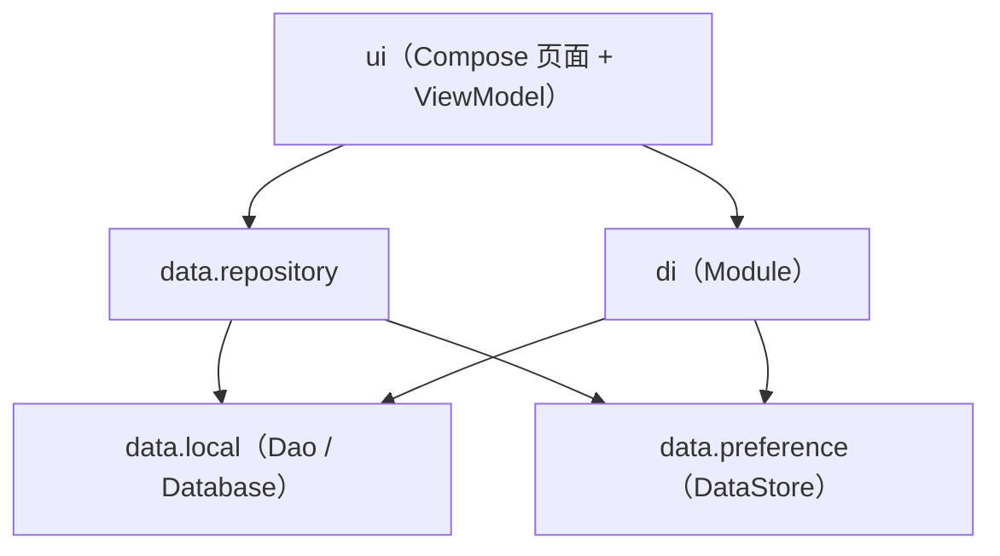

# TaskTracker

**Kotlin + Jetpack Compose + Hilt + Room + DataStore 的纯本地待办清单 App**

严格按照 [`TaskTracker项目实战指南.md`](./TaskTracker项目实战指南.md) 的技术路线、分层结构与版本清单实现：**单模块（`app`）**、不联网、不申请权限、不引第三方 SDK。项目已在本机完成编译、Lint、单元测试，并在 Android 10（API 29）模拟器上完成端到端验收。

## 效果预览

| 任务列表（浅色） | 新增任务（ModalBottomSheet） | 深色主题 |
| :---: | :---: | :---: |
|  |  |  |

| 勾选完成 | 重启后数据仍在 | 隐藏已完成 |
| :---: | :---: | :---: |
|  |  |  |

> 截图均来自 Pixel 6 Pro 模拟器（Android 10 / API 29），由打包后的 debug APK 实机运行截取。

## 功能清单

- **任务列表**：`LazyColumn` + `Flow` 可观察查询，增删改后 UI 自动刷新，无需手动通知
- **新增任务**：独立路由 `add_task`，以 `ModalBottomSheet` 呈现；空标题禁用「添加」
- **完成 / 取消完成**：`Checkbox` 勾选，标题加删除线、颜色变淡
- **删除任务**：行尾垃圾桶按钮，删除后 Snackbar 提示
- **显示 / 隐藏已完成**：开关写进 DataStore，重启后保留
- **主题切换**：浅色 / 深色一键切换，写入 DataStore；系统栏同步跟随；杀进程重开仍生效
- **纯本地**：Room 存任务、DataStore 存偏好，`AndroidManifest.xml` 中无任何权限声明

## 技术栈与版本

| 类别 | 组件 | 版本 |
| --- | --- | --- |
| 构建 | Gradle / AGP | 8.9 / 8.7.3 |
| 语言 | Kotlin / KSP | 2.0.21 / 2.0.21-1.0.28 |
| 平台 | compileSdk / targetSdk / minSdk / JDK | 35 / 35 / 24 / 17 |
| UI | Compose BOM / Material3 | 2024.12.01 / 1.3.1 |
| 导航 | Navigation for Compose | 2.8.5 |
| 持久化 | Room | 2.6.1 |
| 依赖注入 | Hilt | 2.53.1 |
| 偏好 | DataStore Preferences | 1.1.1 |
| 生命周期 | Lifecycle（runtime-ktx / runtime-compose / viewmodel-compose） | 2.8.7 |

版本全部集中在 [`gradle/libs.versions.toml`](gradle/libs.versions.toml)（Gradle 官方 Version Catalog），模块脚本里不写死任何版本号。

## 项目结构

```
TaskTracker/
├── settings.gradle.kts               ← 声明模块与仓库
├── build.gradle.kts                  ← 根构建脚本（插件统一管理，apply false）
├── gradle.properties                 ← JVM 参数 / AndroidX 开关
├── gradle/
│   ├── libs.versions.toml            ← 版本目录（所有依赖版本集中一处）
│   └── wrapper/                      ← Gradle 8.9 wrapper
├── docs/screenshots/                 ← 运行截图
└── app/                              ← 唯一模块
    ├── build.gradle.kts              ← 模块依赖声明
    └── src/
        ├── main/
        │   ├── AndroidManifest.xml
        │   ├── java/com/example/tasktracker/
        │   │   ├── TaskTrackerApp.kt              ← @HiltAndroidApp
        │   │   ├── MainActivity.kt                ← @AndroidEntryPoint + setContent
        │   │   ├── data/
        │   │   │   ├── local/                     ← Room：Task / TaskDao / AppDatabase
        │   │   │   ├── preference/                ← DataStore：ThemeMode / UserPreferences
        │   │   │   └── repository/TaskRepository.kt
        │   │   ├── di/AppModule.kt                ← Room、DataStore 的 @Provides
        │   │   └── ui/
        │   │       ├── theme/                     ← Color / Type / Theme
        │   │       ├── task/                      ← 列表页、添加页、ViewModel
        │   │       └── navigation/                ← Routes + AppNavHost
        │   └── res/                               ← 字符串、启动主题、自适应图标
        └── test/java/…/ThemeModeTest.kt           ← 纯 JVM 单元测试
```

**分层依赖方向（单向，不允许反向）：**



口诀：**UI 只认 Repository，Repository 只认 Dao 与 DataStore，谁创建实例交给 Hilt。**

## 数据流

**新增任务（Room 分支）**

```
点击 FAB → navigate("add_task") → AddTaskSheet 输入标题 → 点击「添加」
→ TaskViewModel.addTask() → viewModelScope.launch
→ TaskRepository.addTask() → TaskDao.insert()（suspend，Room 自动切 IO 线程）
→ 写入 task_tracker.db
→ Room InvalidationTracker 检测到 task 表变化，重新发射 Flow<List<Task>>
→ Repository.allTasks → ViewModel.combine(tasks, theme, showDone) → StateFlow<TaskUiState>
→ TaskListScreen collectAsStateWithLifecycle 收到新值 → Compose 重组
```

**切换主题（DataStore 分支）**

```
拨动 Switch → TaskViewModel.setThemeMode(DARK) → Repository → UserPreferences
→ DataStore.edit { putString("theme_mode", "DARK") }（落盘）
→ themeMode Flow 重新发射 → TaskTrackerTheme 重组全局配色 + 系统栏明暗
→ 杀进程重开：DataStore 读回 DARK，主题保持
```

整条链路**没有任何手写刷新**：Room 的 `Flow` 查询与 DataStore 的 `Flow` 都是响应式数据源，UI 只是状态的投影。

## 快速开始

**环境要求**：JDK 17、Android SDK Platform 35 + Build-Tools 35.0.0、Android Studio Ladybug 及以上（或直接命令行）。

```bash
# 1. 编译 debug APK
./gradlew :app:assembleDebug

# 2. 安装到已连接的设备 / 模拟器（adb 可见）
./gradlew :app:installDebug

# 3. 单元测试
./gradlew :app:testDebugUnitTest

# 4. 静态检查（0 error）
./gradlew :app:lintDebug
```

APK 产物：`app/build/outputs/apk/debug/app-debug.apk`

> Android Studio 打开工程时会根据本机 SDK 自动生成 `local.properties`（已加入 `.gitignore`）。命令行构建前请确认其中的 `sdk.dir` 指向本机 Android SDK。

## 实现要点（对照面试问答）

| 主题 | 本项目做法 |
| --- | --- |
| Hilt 全链路 | `@HiltAndroidApp` 根节点 → `@AndroidEntryPoint` Activity → `@HiltViewModel` + `@Inject constructor` → `@Inject` 的 Repository → `@Provides` 提供 Room/DataStore |
| Room 异步 | 查询返回 `Flow`（可观察查询）+ 增删改 `suspend`；**不手写** `withContext(Dispatchers.IO)` |
| DataStore | 顶层 `by preferencesDataStore` 保证单实例；读取 `Flow`、写入 `suspend`；不阻塞主线程 |
| 状态聚合 | `combine(tasks, themeMode, showDoneTasks)` + `stateIn(WhileSubscribed(5_000))`，旋转屏幕不重建数据流 |
| Compose 订阅 | `collectAsStateWithLifecycle()`，退后台自动停止订阅 |
| 列表 diff | `LazyColumn` 的 `items(key = { it.id })`，删除时状态不串行 |
| 全局反馈 | Snackbar 挂在 NavHost 外层，切页不丢失；上移 88dp 避免遮挡 FAB |
| 主题 | `ThemeMode`（SYSTEM/LIGHT/DARK）→ 配色 + 系统栏明暗统一跟随，重启保留 |
| Room 迁移 | Demo 用 `fallbackToDestructiveMigration()`；生产应写 `Migration` 并 `addMigrations` |

## 与实战指南的差异（均为可运行性修正或体验增强）

指南正文中的代码片段存在几处会导致**编译失败或运行异常**的问题，落地时已修正：

| # | 位置 | 调整 | 原因 |
| --- | --- | --- | --- |
| 1 | `app/build.gradle.kts` + 版本目录 | 新增 `androidx.lifecycle:lifecycle-runtime-compose` | `collectAsStateWithLifecycle()` 自 Lifecycle 2.8 起在该独立库中，指南依赖清单遗漏，否则编译报 `Unresolved reference` |
| 2 | `TaskRepository` | 构造函数补 `@Inject` | 指南文字写明「构造注入」，但代码片段漏写注解；缺少时 Hilt 编译期报 `TaskRepository cannot be provided` |
| 3 | `TaskListScreen` | 补 `@OptIn(ExperimentalMaterial3Api::class)` | `TopAppBar` 在 Material3 1.3.1 中仍标注实验性，与 `ModalBottomSheet` 同理 |
| 4 | `TaskListScreen` | `Divider()` → `HorizontalDivider()` | Material3 1.2+ 已废弃 `Divider`，指南却声称「不含废弃 API」 |
| 5 | `AndroidManifest.xml` | 把 `<!-- 指向自定义 Application -->` 移到标签外 | 指南示例把注释写在 `<application>` 属性列表中间，不是合法 XML，aapt2 会直接报错 |
| 6 | `Theme.kt` | 补 `primaryContainer / surfaceContainerLow` 等色板，FAB 用 `primary` | 默认 M3 容器色是紫色基线的淡紫，与靛蓝主色不协调 |
| 7 | `Theme.kt` | `SideEffect` 中同步系统栏颜色与图标明暗 | 指南只切 Compose 配色，深色主题下导航栏仍是白色 |
| 8 | `AppNavHost` + `SnackbarHost` | 外层 Scaffold `contentWindowInsets = WindowInsets(0)` 并消费 `innerPadding`，Snackbar 加 `navigationBarsPadding()` + 88dp 底部留白 | 满足 Lint `UnusedMaterial3ScaffoldPaddingParameter`；同时避免 Snackbar 遮挡 FAB |
| 9 | `res/` | 新增自适应图标、monochrome 与各密度 PNG | 指南 Manifest 引用 `@mipmap/ic_launcher`，但未提供图标资源，缺失会构建失败 |
| 10 | 工程配套 | 单元测试、README、运行截图、Gradle Wrapper | 让工程可一键构建、可验证、可展示 |

此外，开关补充了 `contentDescription` 语义，提升无障碍可读性；`TaskRow` 的列表项使用 `contentType`，长列表复用更稳定。

## 验收记录

在 Pixel 6 Pro 模拟器（Android 10 / API 29，`emulator-5554`）上实测：

| 验收项 | 结果 | 证据 |
| --- | --- | --- |
| 点「+」能加任务 | ✅ | `04-first-task.png` |
| 列表即时出现（Room Flow） | ✅ | `05-two-tasks.png` |
| 勾选后有删除线 | ✅ | `06-task-done.png` |
| 删除后任务消失 | ✅ | `10-delete-task.png` |
| 拨 Switch 全局变色 | ✅ | `07-dark-theme.png` |
| 杀进程重开任务与主题都在 | ✅ | `08-persisted-after-restart.png` |
| 隐藏已完成任务 | ✅ | `09-hide-done.png` |
| 无崩溃 / 无权限 | ✅ | `adb logcat` 无 `FATAL EXCEPTION`，Manifest 无 `<uses-permission>` |

构建与测试命令结果：

```text
:app:assembleDebug        BUILD SUCCESSFUL
:app:testDebugUnitTest    BUILD SUCCESSFUL（2 个测试用例通过）
:app:lintDebug            BUILD SUCCESSFUL（0 error；warning 均为「依赖有更新版本」提示）
```

## 面试展示话术（30 秒）

> 「TaskTracker 是一个纯本地的待办 App：Compose 做声明式 UI，Room 管任务持久化，DataStore 管主题偏好，Hilt 负责全链路依赖注入。数据层用 Repository 统一封装两个数据源，ViewModel 通过 `combine` 把多个 Flow 合成一个 `StateFlow` 暴露给 UI。整个 App 是响应式单向数据流——数据库一变 UI 就自动重组，不需要手动刷新。没有网络、没有权限，聚焦 Jetpack 五件套的本地协同。」

> 更完整的简历描述、项目讲述模板与 50+ 道面试问答（含追问与加分点）见 [docs/简历与面试准备.md](docs/简历与面试准备.md)。

## 说明

- 本项目仅用于学习与面试展示；`local.properties`、构建产物、`.gradle`、`.kotlin` 均已加入 `.gitignore`。
- 指南原文保留在仓库根目录，方便对照每一条技术路线与代码位置。
